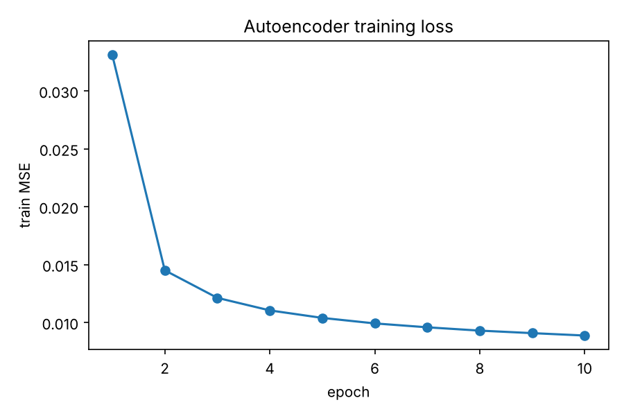
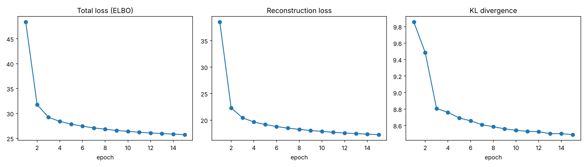
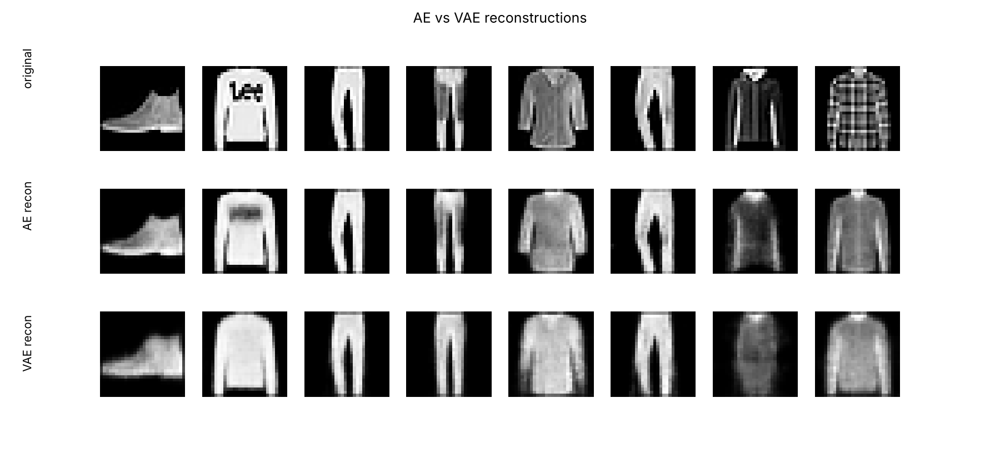
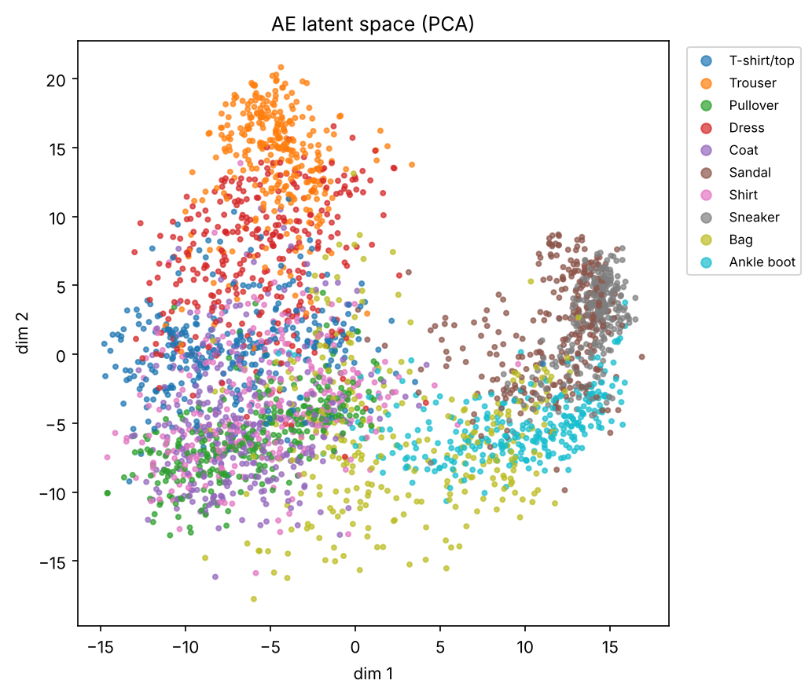
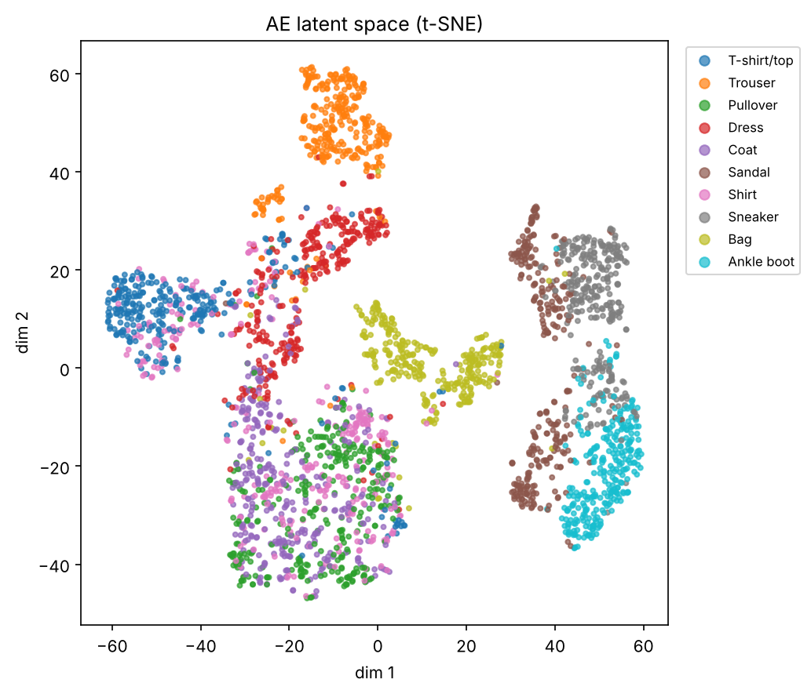
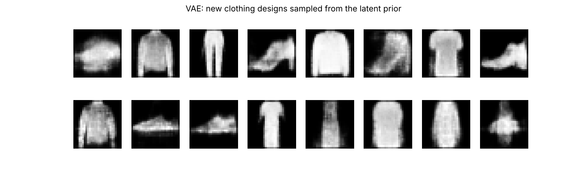
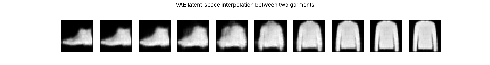

# Fashion-Tech Image Generation: AE + VAE on Fashion-MNIST

Step 10 write-up: evaluation and results summary for the course submission.

## Problem statement

A fashion-tech company wants an AI system that can do two related things with
clothing images: learn what makes different garments visually distinct
(representation learning), and produce brand-new, plausible-looking garment
images from that learned understanding (generation). The intended uses are
product design ideation, quick marketing-asset prototypes, and synthetic
training data for other downstream models. This project builds and evaluates
a small prototype of that pipeline: a convolutional Autoencoder (AE) for the
representation half, and a Variational Autoencoder (VAE) built on the same
backbone for the generation half, both trained on Fashion-MNIST as a fast,
low-risk proof of concept before investing in a production-scale dataset.

## Dataset

[Fashion-MNIST](https://github.com/zalandoresearch/fashion-mnist) consists of
60,000 training images and 10,000 test images, each a 28x28 grayscale photo
of a single clothing item drawn from 10 categories: T-shirt/top, Trouser,
Pullover, Dress, Coat, Sandal, Shirt, Sneaker, Bag, and Ankle boot. It was
chosen for this stage because it loads directly through
`torchvision.datasets.FashionMNIST` with no manual cleaning, and its small
size and resolution keep training fast enough (minutes, on a CPU) to iterate
on the AE/VAE architecture and training loop. As documented in
`docs/DECISIONS.md`, the plan is to migrate this same pipeline to the
higher-resolution, real-photo [DeepFashion](http://mmlab.ie.cuhk.edu.hk/projects/DeepFashion.html)
dataset once it is validated end-to-end on Fashion-MNIST — that migration is
future work, not part of this submission.

## Approach

**Autoencoder (representation learning).** A convolutional encoder
(two `Conv2d` + ReLU layers, 28x28 -> 14x14 -> 7x7, flattened into a single
fully-connected layer) compresses each image into a 32-dimensional latent
vector — roughly a 24x reduction from the 784 raw pixels. A mirrored
decoder (fully-connected layer + two `ConvTranspose2d` layers) reconstructs
the 28x28 image from that vector. It is trained end-to-end with pixel-wise
MSE loss between the input and its reconstruction. This latent bottleneck is
what forces the network to learn compact, meaningful visual features rather
than memorizing pixels.

**VAE (generation).** The VAE reuses the exact same conv encoder/decoder
backbone and the same `latent_dim=32`, so the two models are directly
comparable, but changes what the encoder outputs and how training is
regularized:

- Instead of a single latent vector, the encoder outputs a mean (`mu`) and
  log-variance (`logvar`) describing a small Gaussian distribution per input
  image.
- The **reparameterization trick** (`z = mu + eps * std`, with
  `eps ~ N(0, 1)`) draws a sample from that distribution in a way that stays
  differentiable, so the whole model can still be trained with backprop.
- A **KL-divergence term** pulls every image's `(mu, logvar)` distribution
  toward the standard normal `N(0, I)`, in addition to the usual
  reconstruction loss. This is what turns the latent space from the AE's
  "islands that happen to decode well" into a single continuous, densely
  packed space where *every* point is decodable into something plausible —
  which is the property that makes sampling brand-new images possible.

The full reasoning behind these choices (loss formulation, why MSE over BCE,
why sum-reduction, epoch counts, etc.) is logged in `docs/DECISIONS.md` and
is not repeated in full here.

## Results

Training curves:

The AE's train MSE dropped from 0.037 to 0.009 over 10 epochs, a smooth,
monotonic decline. The VAE's total loss (ELBO) dropped from 48.4 to 25.7
over 15 epochs, with its reconstruction term falling from 38.5 to 17.2 and
its KL term settling around 8.5 (down from 9.9) rather than collapsing to
0 — meaning the latent space is genuinely being used to encode information,
not being ignored by the decoder (a common VAE failure mode called
"posterior collapse").

Qualitatively, the VAE's reconstructions are visibly a little blurrier than
the AE's (fine details like logos or plaid patterns soften more). The
quantitative evaluation below confirms this on the full 10,000-image test
set, not just a training batch:

| Model | MSE | SSIM |
|-------|-----|------|
| AE | 0.00892 | 0.7828 |
| VAE | 0.02251 | 0.5808 |

*(full methodology and script: `src/evaluate.py`; raw numbers also saved to
`outputs/eval_metrics.csv`)*

These are averages over all 10,000 held-out test images (not a single
batch), so they are a fair representation of each model's generalization
performance. The AE reconstructs test images about 2.5x more accurately by
pixel-wise MSE and noticeably more faithfully by SSIM (0.78 vs. 0.58) than
the VAE. This matches, and quantifies, the qualitative blur visible in
`ae_vs_vae_reconstructions.png` above, and is consistent with each model's
own training-time reconstruction loss (the VAE's final per-pixel
reconstruction loss was already about 2.5x the AE's final MSE during
training, before any held-out evaluation). Two things amplify the VAE's
numbers specifically: the SSIM window-based comparison is more sensitive to
the smoothing/blur the KL term induces than raw MSE is, and the VAE
reconstructions evaluated here go through its actual stochastic forward
pass (sampling `z` via reparameterization, as the model is used everywhere
else in this project) rather than a deterministic `mu`-only decode, so each
reconstruction also carries a little genuine sampling noise on top.

This is the expected and acceptable trade-off described in
`docs/DECISIONS.md`: the AE optimizes purely for reconstruction fidelity, so
it wins on both metrics, while the VAE spends some of its capacity
satisfying the KL term that keeps its latent space continuous and
samplable. A plain AE cannot reliably generate new images at all (most
points in its latent space don't decode to anything realistic — there is no
mechanism in this report's AE to even attempt it), so a real but moderate
drop in reconstruction quality is a reasonable price for gaining that
capability — which is exactly what the business brief asks for.

## Representation learning (latent space)

Projecting the AE's 32-dimensional latent vectors down to 2D (PCA for a
linear, global view; t-SNE for a non-linear, local view) on 3,000 test
images shows that the encoder has learned real, semantically meaningful
visual structure without ever being told the class labels during training:
footwear (Sneaker, Sandal, Ankle boot), Trousers, and Bags each form clearly
separated clusters in both projections. Upper-body garments (Pullover,
Coat, Shirt, T-shirt/top) overlap heavily with each other in both views.
That overlap is not a sign the encoder failed — those four categories really
do look alike at 28x28 resolution (similar silhouette, similar rectangular
torso shape), so an encoder relying on visual features alone *should* find
them hard to separate. Taken together, these plots validate that the AE's
latent space captures genuine visual characteristics of the clothing
(silhouette/category), satisfying the "representation learning" half of the
business brief.

## Generation results

The first figure feeds 16 vectors sampled fresh from the VAE's prior,
`z ~ N(0, I)`, directly into the decoder — none of these images come from
encoding a real photo first, so each one is a genuinely new, synthetic
garment design. Several are clearly recognizable as specific garment types
(shoes, trousers, sweaters, boots); a few are blobbier/ambiguous, which is
expected from a simple, non-conditional VAE at this scale. The second figure
linearly interpolates between the latent means of two different-class test
images (an ankle boot and a pullover) in 10 steps and decodes each one,
producing a smooth, gradual morph with no jarring jumps between steps. Both
results directly demonstrate the "generate new, realistic-looking clothing
designs" requirement from the brief: the random samples show the model can
invent plausible designs from nothing but noise, and the smooth
interpolation shows the latent space itself is continuous and well-organized
rather than a patchwork of disconnected memorized points — exactly the
property a plain AE's latent space does not reliably have.

## Business takeaway

This prototype is a small-scale proof that the AE -> VAE pipeline works: the
AE demonstrates that a fashion-tech company can learn a compact, meaningful
representation of garment images (useful for search, tagging, or similarity
tools), while the VAE demonstrates the generative capability needed for
marketing-prototype mockups, rapid design ideation, and generating synthetic
training data to augment a smaller real dataset. For production use, the
same two-stage approach would need to move to higher-resolution color images
(Fashion-MNIST's 28x28 grayscale icons are far simpler than real product
photography), train on the planned DeepFashion dataset (or a company's own
catalog) instead of Fashion-MNIST, and likely train substantially longer
with a deeper architecture to get crisp, client-ready output rather than the
blurry low-resolution samples shown here.

## Limitations and next steps

- **Fashion-MNIST vs. real fashion photos:** 28x28 grayscale icons are far
  simpler than real garment photography (no color, texture, lighting,
  pose, or background) — this is exactly why `docs/DECISIONS.md` already
  plans a migration to the higher-resolution, real-photo DeepFashion dataset
  as the next stage, once this pipeline's correctness was validated here.
- **Blur at this resolution/capacity:** both the AE and especially the VAE
  lose fine detail (logos, patterns, text) at 28x28 with a 32-dim latent
  space; a deeper architecture, a larger latent dimension, or a perceptual
  loss term would likely sharpen results, particularly for the VAE.
- **No conditional generation yet:** this project's AE/VAE can only sample
  an arbitrary garment, not "generate a sneaker" or "generate a coat" on
  request — that would require a conditional VAE (feeding the class label
  into the encoder/decoder) as a future extension.
- **SSIM/MSE are pixel-level proxies:** they measure pixel-wise fidelity,
  not perceptual or design quality — a human/stakeholder review of generated
  samples would still be needed before using this for actual marketing
  assets.
